# Study Planner

Full-Stack-Web-App, mit der Studierende ihr Semester organisieren: Stundenplan, Klausuren, Aufgaben mit Deadline,
Lernzeiten, Kalender und ein Dashboard mit Statistiken.

**Java 21 · Spring Boot 3.5 · PostgreSQL · React 19 · TypeScript · Docker**

## Funktionen

- **Stundenplan** – wöchentliche Veranstaltungen (Vorlesung, Übung, Praktikum, Seminar) mit Raum, Dozent, ECTS, Farbe und Semesterzeitraum
- **Klausuren** – Countdown, Noten und Notenschnitt, Filter nach Zeitraum, Kurs und Suchtext
- **Aufgaben** – Deadlines, Priorität, Status, Überfällig-Markierung, Abhaken per Checkbox
- **Lernfortschritt** – Lerneinheiten erfassen, Lernzeit pro Tag und Kurs, Aufgabenfortschritt pro Kurs
- **Kalender** – Monatsansicht mit Veranstaltungen, Klausuren und Deadlines
- **Dashboard & Suche** – Kennzahlen, heutige Termine, nächste Klausuren, globale Suche über alle Daten
- **Konto** – Registrierung mit E-Mail-Bestätigung, „Passwort vergessen“, Name/Passwort ändern, Konto löschen
- Responsives Layout (Smartphone bis Desktop) und automatischer Dark Mode

## Technische Highlights

- **REST-API** mit Bean Validation, einheitlichem Fehlerformat nach RFC 9457 (Problem Details) und passenden Statuscodes
- **Authentifizierung**: kurzlebiges JWT-Access-Token (15 min) im Arbeitsspeicher + rotierendes Refresh-Token im
  httpOnly-Cookie (`SameSite=Strict`), Erkennung wiederverwendeter (gestohlener) Refresh-Tokens, BCrypt-Passwörter
- **Kontosicherheit**: E-Mail-Bestätigung und Passwort-Reset mit Einmal-Tokens (nur als SHA-256-Hash gespeichert),
  Login-Sperre nach Fehlversuchen, keine Preisgabe registrierter Adressen (User-Enumeration), Datenisolation pro Benutzer
- **Härtung**: Anfrage-Limits pro IP in nginx, Content-Security-Policy und weitere Sicherheits-Header,
  Start wird verweigert bei öffentlich bekannten Schlüsseln, geschützter und nächtlich zurückgesetzter Demo-Account
- **Datenbank**: PostgreSQL mit versionierten Flyway-Migrationen, Fremdschlüssel mit `CASCADE`/`SET NULL`,
  CHECK-Constraints, Indizes und Aggregationen (`SUM`, `COUNT`, `AVG`, `GROUP BY`)
- **Dynamische Filter** mit der JPA Criteria API (Specifications), N+1-Abfragen vermieden per `@EntityGraph`
- **Hintergrundaufgaben**: E-Mail-Versand erst nach erfolgreichem Speichern (asynchron), nächtliches Aufräumen
  unbestätigter Konten und abgelaufener Tokens
- **Frontend**: typisierte API-Schicht mit automatischer Token-Erneuerung, geschützte Routen, eigene Dialoge,
  Formulare mit Fehleranzeige pro Feld, optimistische Updates – ohne UI-Bibliothek
- **Tests & CI**: 43 Backend-Tests gegen echtes PostgreSQL (JUnit 5, MockMvc, Testcontainers) und
  24 Frontend-Tests (Vitest), GitHub-Actions-Pipeline
- **Betrieb**: Docker-Multi-Stage-Builds, Docker Compose mit Healthchecks, nginx als Reverse Proxy, Mailpit als
  Test-Postfach

## Schnellstart

Voraussetzung: [Docker Desktop](https://www.docker.com/products/docker-desktop/)

```bash
git clone https://github.com/OmarAlkaadi/study-planner.git
cd study-planner
cp .env.example .env        # Windows PowerShell: Copy-Item .env.example .env
docker compose up --build
```

| Dienst | Adresse |
|---|---|
| App | http://localhost:3000 |
| Test-Postfach (Mailpit) | http://localhost:8025 – hier landen Bestätigungs- und „Passwort vergessen“-Mails |

**Demo-Account mit Beispieldaten:** `demo@studyplanner.de` / `demo1234`
(Kontodaten gesperrt, Beispieldaten werden jede Nacht zurückgesetzt; abschaltbar mit `APP_DEMO_DATA=false`)

## Konfiguration

Alle Einstellungen stehen kommentiert in [`.env.example`](.env.example). Die wichtigsten:

| Variable | Bedeutung |
|---|---|
| `JWT_SECRET` | Schlüssel zum Signieren der Login-Tokens (mindestens 32 Zeichen). Leer = zufälliger Schlüssel bei jedem Start |
| `DB_PASSWORD` | Passwort der Datenbank – wird nur beim allerersten Start übernommen |
| `APP_DEMO_DATA` | Demo-Account mit Beispieldaten anlegen (`true`/`false`) |
| `AUTH_COOKIE_SECURE` | Auf einem Server mit HTTPS auf `true` setzen |

## Lokale Entwicklung

Voraussetzungen: Java 21, Maven 3.9+, Node.js 22+, Docker

```bash
docker compose up db mailpit              # nur Datenbank und Test-Postfach

cd backend && mvn spring-boot:run         # Backend auf Port 8080
cd frontend && npm install && npm run dev # Frontend auf Port 5173 (leitet /api an Port 8080 weiter)
```

## Tests

```bash
cd backend && mvn verify                  # Unit- und Integrationstests (startet PostgreSQL per Testcontainers, Docker nötig)
cd frontend && npm test && npm run lint && npm run build
```

Die GitHub-Actions-Pipeline führt alle Tests und Builds bei jedem Push aus.

## Architektur

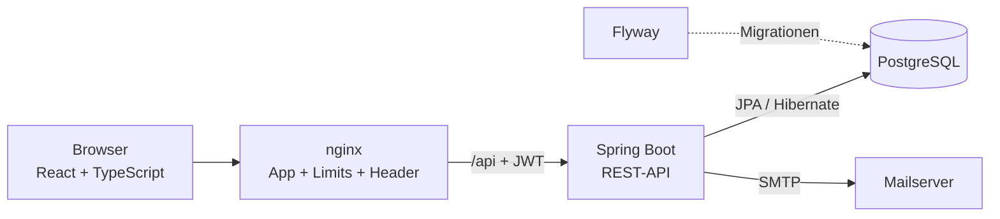

Das Backend ist nach Fachlichkeit aufgeteilt (Package-by-Feature) – jedes Paket enthält Entity, Repository,
Service, Controller und DTOs:

```
backend/src/main/java/de/studyplanner/
├── auth/          Registrierung, Login, Tokens, E-Mail-Bestätigung, Passwort-Reset, Aufräum-Job
├── account/       Eigenes Konto verwalten
├── course/        Veranstaltungen
├── exam/          Klausuren
├── task/          Aufgaben
├── studysession/  Lerneinheiten
├── dashboard/     Statistiken
├── calendar/      Kalender
├── search/        Globale Suche
├── demo/          Demo-Account (geschützt, nächtlich zurückgesetzt)
├── common/        Fehlerbehandlung, Hilfsklassen
└── config/        Security- und Scheduling-Konfiguration
```

## API-Übersicht

Geschützte Endpunkte erwarten den Header `Authorization: Bearer <access-token>`.

| Bereich | Endpunkte |
|---|---|
| Anmeldung (öffentlich) | `POST /api/auth/register`, `/verify-email`, `/login`, `/refresh`, `/logout`, `/forgot-password`, `/reset-password` |
| Konto | `GET /api/auth/me`, `PUT /api/account/profile`, `PUT /api/account/password`, `DELETE /api/account` |
| Kurse | `GET/POST /api/courses`, `GET/PUT/DELETE /api/courses/{id}` |
| Klausuren | `GET/POST /api/exams?courseId=&upcoming=&q=`, `GET/PUT/DELETE /api/exams/{id}` |
| Aufgaben | `GET/POST /api/tasks?status=&priority=&courseId=&q=`, `GET/PUT/DELETE /api/tasks/{id}`, `PATCH /api/tasks/{id}/status` |
| Lerneinheiten | `GET/POST /api/study-sessions?courseId=`, `PUT/DELETE /api/study-sessions/{id}` |
| Auswertungen | `GET /api/dashboard`, `GET /api/dashboard/progress`, `GET /api/calendar?from=&to=`, `GET /api/search?q=` |

## Screenshots

| Dashboard | Kalender |
|---|---|
| 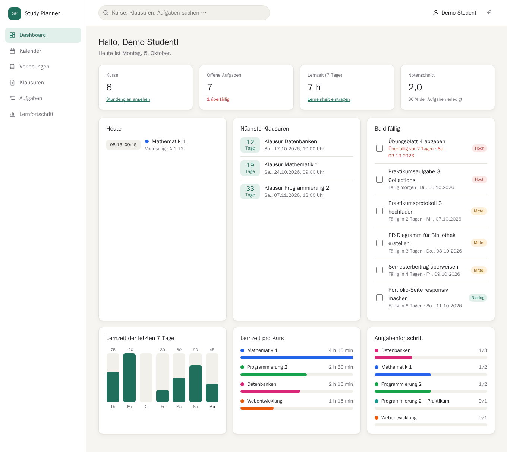 | 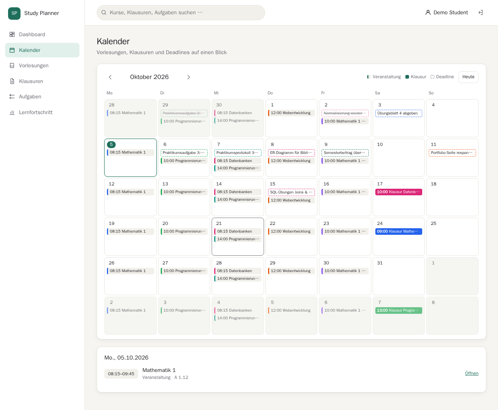 |

| Stundenplan | Klausuren |
|---|---|
| 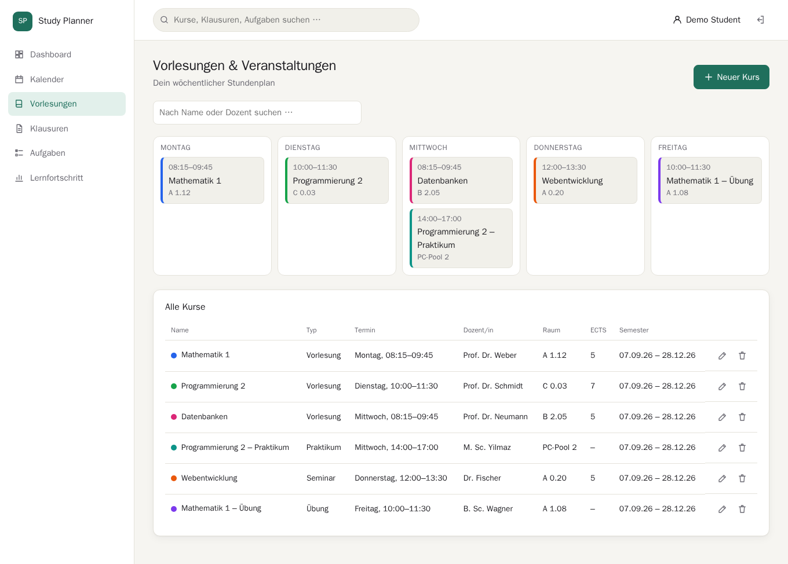 | 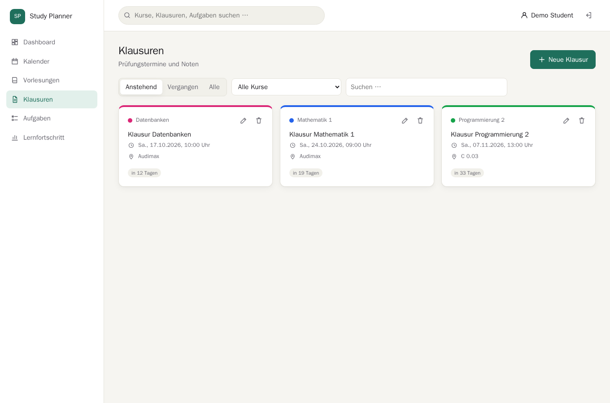 |

| Aufgaben | Lernfortschritt |
|---|---|
| 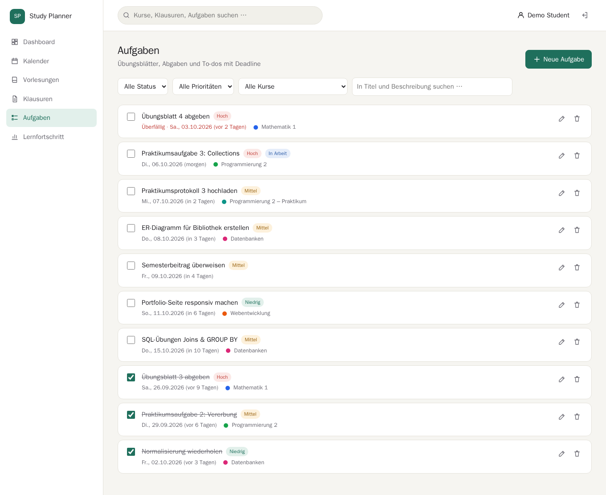 | 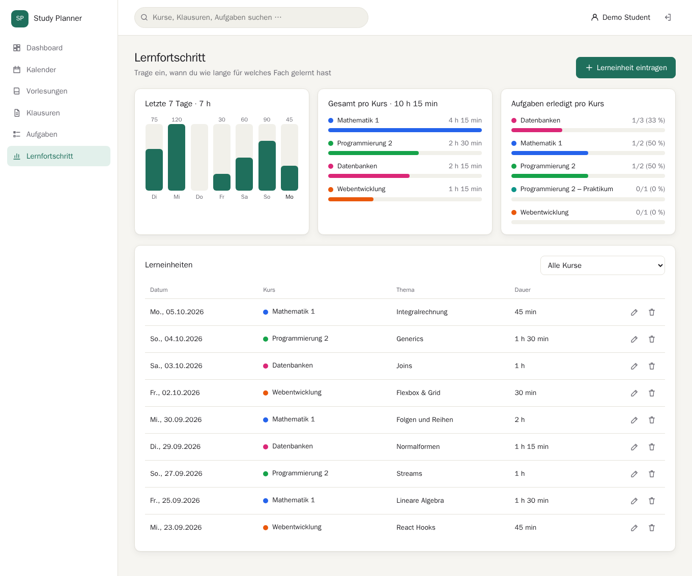 |

| Konto (Demo gesperrt) | Login |
|---|---|
| 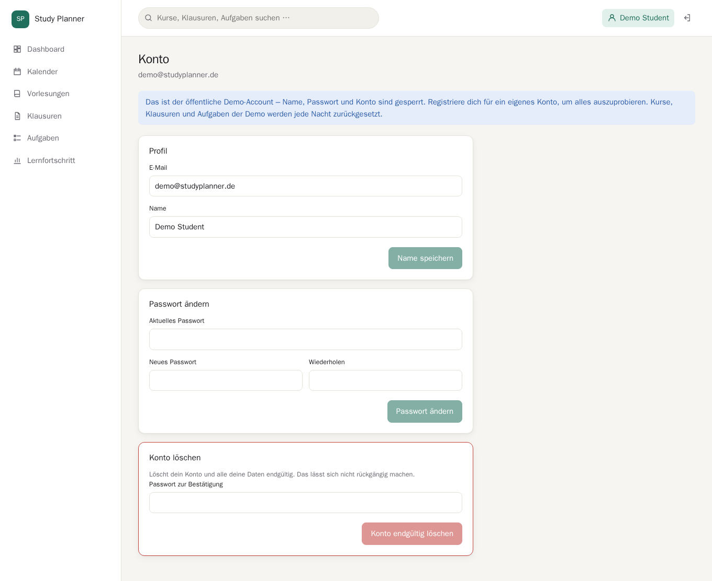 | 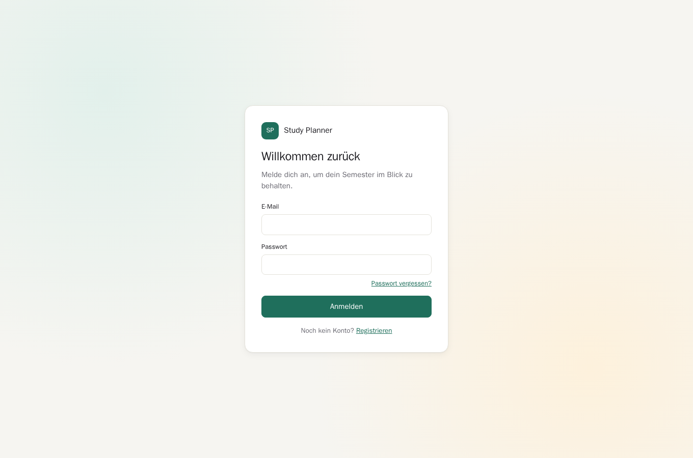 |

| Dark Mode | Mobil |
|---|---|
| 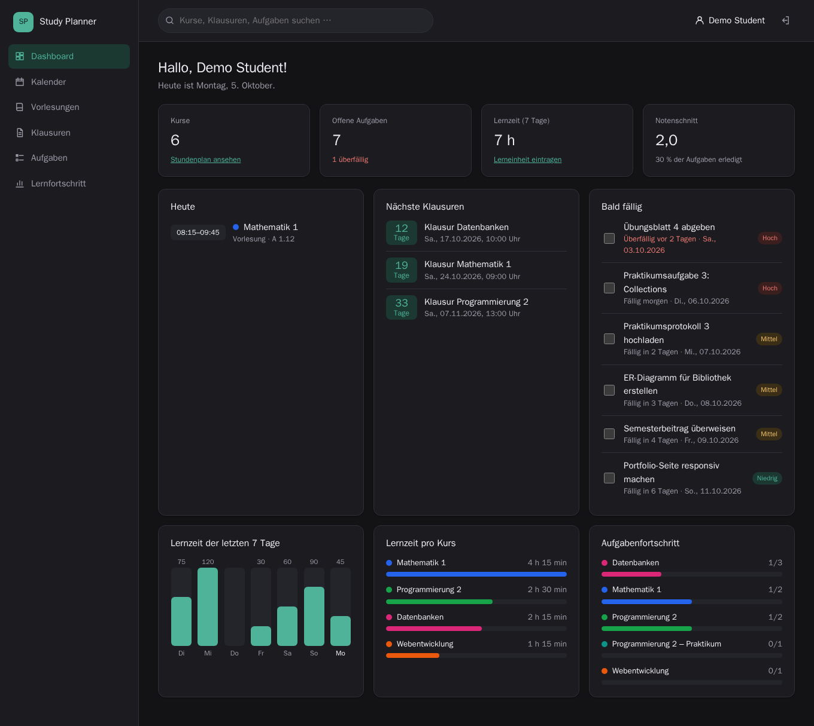 | 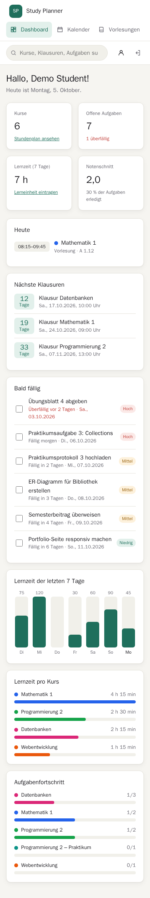 |